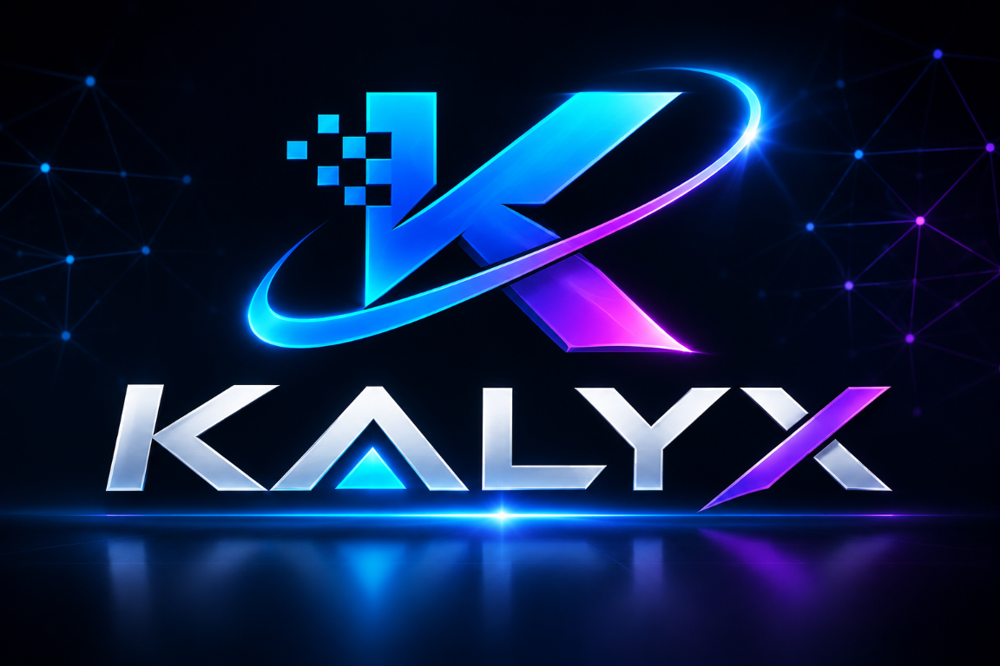

# KALYX



KALYX is a local C# code-analysis tool. It parses a workspace with Roslyn into a confidence-scored knowledge graph, then answers questions about dependencies, architecture risks, hotspots and the likely blast radius of a change. It has a command-line interface, an interactive HTML visualization and an MCP server, so AI assistants such as Claude can query the graph.

Analysis is fully local: your source code is never sent to an external service by KALYX.

## Contents

- [Features](#features)
- [Requirements](#requirements)
- [Install](#install)
- [Quick start](#quick-start)
- [Commands](#commands)
- [Graph output](#graph-output)
- [MCP server](#mcp-server)
- [Claude skill](#claude-skill)
- [Reading the results](#reading-the-results)
- [Limitations](#limitations)
- [Privacy and security](#privacy-and-security)
- [Project structure](#project-structure)
- [Development and contributing](#development-and-contributing)
- [License](#license)

## Features

- Builds a knowledge graph from C# source with Roslyn.
- Detects files, namespaces, classes, interfaces, records, structs and methods.
- Extracts inheritance, interface implementation, imports, references and method invocations.
- Marks each link as **Extracted** (resolved directly) or **Inferred** (matched by name), with a confidence value.
- Finds dependency paths, cycles, over-connected "god nodes" and unstable modules.
- Calculates change blast radius and a 0-100 risk score.
- Combines coupling with Git history to find hotspots and trends.
- Compares two graph snapshots.
- Exports JSON, Mermaid, Graphviz DOT and a standalone interactive HTML page.
- Serves five analysis tools over MCP (JSON-RPC on standard input/output).

## Requirements

- .NET 8 SDK (or a compatible newer SDK)
- Windows, Linux or macOS
- Git (optional; required only for `hotspots`, `trend` and `changed`)

## Install

### Option 1: build from source

```powershell
git clone <repo-url>
cd Kalyx
dotnet restore Kalyx.slnx
dotnet build Kalyx.slnx -c Release
```

The program is then at `src/Kalyx.Cli/bin/Release/net8.0/Kalyx.exe` (`Kalyx` on Linux and macOS).

### Option 2: .NET tool

The CLI project is packaged as a .NET tool (command `kalyx`). Once it is published to a NuGet feed:

```powershell
dotnet tool install -g Kalyx
kalyx help
```

To build the package yourself: `dotnet pack src/Kalyx.Cli -c Release` (output in `src/Kalyx.Cli/nupkg`).

### Option 3: self-contained download

```powershell
dotnet publish src/Kalyx.Cli -c Release -r win-x64 --self-contained -o dist/kalyx-win-x64
```

Zip `dist/kalyx-win-x64` and share it. Users do not need the SDK.

In the examples below, `kalyx` means whichever of these you use. If it is not on your PATH, use the full path to `Kalyx.exe`.

## Quick start

```powershell
# 1. Index a project
kalyx parse C:\path\to\project --out myproject-graph.json

# 2. Health check
kalyx smells --graph myproject-graph.json

# 3. What would a change affect?
kalyx impact "OrderService" --graph myproject-graph.json

# 4. Explore visually
kalyx viz myproject-graph.json --out myproject-graph.html
```

Re-run `parse` after code changes: the graph is a snapshot.

## Commands

| Command | Purpose |
|---|---|
| `parse [dir] [--out graph.json]` | Parse C# files into a graph file. |
| `parse-multi <dir>` | Combine several repositories into one graph. |
| `query <pattern> [--type method] [--limit 25]` | Search nodes by name or kind. |
| `path <from> <to> [--graph G]` | Find a dependency path between two entities. |
| `explain <node> [--graph G]` | Show incoming, outgoing and related links. |
| `viz [graph.json] [--out graph.html]` | Interactive HTML visualization. |
| `mermaid [graph.json] [--all] [--out graph.mmd]` | Export Mermaid syntax. |
| `export dot [graph.json] [--out graph.dot]` | Export Graphviz DOT. |
| `cycles [--graph G]` | Detect circular dependencies. |
| `smells [--graph G]` | Cycles, god nodes and unstable modules. |
| `hotspots [--top 15] [--repo .] [--graph G]` | Coupling combined with Git churn. |
| `impact <file\|symbol> [--depth 4] [--min-confidence 0.5] [--format json]` | Reverse-dependency blast radius and risk. |
| `trend [--interval 3M] [--threshold 30] [--top 15]` | File-level hotspot trends over Git history. |
| `diff <before.json> <after.json>` | Added and removed entities and links. |
| `changed [--staged] [--format json] [--graph G]` | Analyze files changed in Git. |
| `ask <question> [--graph G]` | Answer common graph questions. |
| `mcp [--graph G]` | Start the MCP server on standard input/output. |
| `help` | Show the current syntax. |

`--graph` defaults to `graph.json`.

## Graph output

**JSON** (`graph.json` by default) contains:

- `SchemaVersion` and `KalyxVersion`
- `Nodes`: files, namespaces, types and methods, each with `Id`, `Name`, `Kind`, `File`, `Line`, `Community` and `Neighbors`
- `Edges`: `FromId`, `ToId`, `Kind` (`contains`, `defines`, `invokes`, `implements`, and so on), `Weight`, `Confidence` and `Origin`

**HTML** (`viz`) is a standalone page with embedded data and the KALYX logo. Open it directly in a browser or share it as a single file.

## MCP server

Start it manually to check that it works (it waits silently for input; press Ctrl+C to stop):

```powershell
kalyx mcp --graph C:\path\to\myproject-graph.json
```

Register it in **Claude Code** (use absolute paths; `--scope user` makes it available from any folder):

```powershell
claude mcp add --scope user kalyx -- C:\path\to\Kalyx.exe mcp --graph C:\path\to\myproject-graph.json
claude mcp list
```

Register it in **Claude Desktop** by adding to `claude_desktop_config.json` (then restart the app):

```json
{
  "mcpServers": {
    "kalyx": {
      "command": "C:\\path\\to\\Kalyx.exe",
      "args": ["mcp", "--graph", "C:\\path\\to\\myproject-graph.json"]
    }
  }
}
```

### Tools

| Tool | Input | Returns |
|---|---|---|
| `kalyx_query` | `pattern`, optional `kind` | Up to 25 matching nodes |
| `kalyx_path` | `from`, `to` | Dependency path between two entities |
| `kalyx_impact` | `node`, optional `depth` (default 4) | Risk score (0-100), grade and dependents by depth |
| `kalyx_smells` | none | Counts of cycles, god nodes and unstable modules |
| `kalyx_explain` | `node` | Incoming and outgoing links of one entity |

### Protocol details

- Newline-delimited JSON-RPC 2.0 over stdin/stdout; protocol version `2024-11-05`.
- Supported methods: `initialize`, `notifications/initialized`, `tools/list`, `tools/call`, `ping`.
- The server is read-only. It reads the graph file once at start-up and keeps it in memory. **After re-running `parse`, restart the MCP server (restart the Claude session or reconnect) to load the new graph.**
- The MCP `kalyx_smells` returns counts only; run the CLI `kalyx smells` for the names.

## Claude skill

A Claude skill, `kalyx-code-analysis`, teaches Claude when and how to use KALYX (setup, commands, reading results and limits). Copy its folder to `~/.claude/skills/kalyx-code-analysis/` (all projects) or `.claude/skills/kalyx-code-analysis/` (one project).

## Reading the results

- **Cycles: 0** means no circular dependencies.
- **God nodes** are the most connected items. Common helper or framework names (for example `Trim`) are matched by name and are usually noise. Files or classes holding many types are the real signal.
- **Instability 1.00** means a file uses other code but nothing visibly uses it. This is often a false alarm for code reached through dependency injection, attributes, reflection or configuration.
- **Inferred** links are lower-confidence than **Extracted** ones.
- **Impact** shows reverse dependencies in the graph. Zero dependents does not prove a change is safe (see Limitations).

## Limitations

- Only C# (`.cs`) files are analyzed; other languages are ignored.
- `bin/`, `obj/`, `.git/`, `.vs/`, `.idea/`, `node_modules/` and `packages/` are skipped.
- Calls into NuGet packages or prebuilt DLLs may appear as lower-confidence Inferred links, because KALYX reads source files only.
- Top-level statements (such as a minimal ASP.NET Core `Program.cs`) are not indexed, and dependency-injection registration, middleware and attribute-based wiring are invisible. Check those by hand before concluding something is unused.
- Hotspot, trend and changed-file analysis need Git (`--repo <path>` points at the repository).
- The MCP server handles malformed requests poorly in some cases (for example a non-integer `depth`) and may exit; restart it if it disconnects.

## Privacy and security

- KALYX makes no network calls and runs no external services.
- The MCP server only reads the graph file; it does not write files or start processes.
- Graph files contain file paths, class and method names, line numbers and the links between them, but not source code bodies. When an AI client queries the MCP server, that text is passed to the AI model, so follow your organization's rules for sharing code structure.
- Do not commit generated graph files (`*-graph.json`, `*-graph.html`) to a public repository when they describe private code.

## Project structure

```text
Kalyx.slnx
src/
  Kalyx.Core/          graph models, parsing, indexing, analysis, exports
    GraphStore.cs
    Models/
    Parsing/
    Indexing/
  Kalyx.Cli/           command-line entry point and MCP server
    Program.cs
    McpServer.cs
tests/
  Kalyx.Tests/         graph behavior and parser tests
assets/
  kalyx-logo.png
kalyx-spec.txt         implementation specification
```

## Development and contributing

```powershell
dotnet clean Kalyx.slnx
dotnet build Kalyx.slnx
dotnet test Kalyx.slnx
```

Contributions are welcome:

1. Fork the repository and create a branch.
2. Add or update tests in `tests/Kalyx.Tests` for any behavior change.
3. Make sure `dotnet build` and `dotnet test` pass.
4. Open a pull request describing the change.

Where to add things:

- **New CLI command:** `src/Kalyx.Cli/Program.cs`
- **New MCP tool:** add it to the tool list and the `CallTool` switch in `src/Kalyx.Cli/McpServer.cs`
- **New analysis:** `src/Kalyx.Core/Indexing/`
- **Parsing changes:** `src/Kalyx.Core/Parsing/CSharpParser.cs`

## License

Released under the [MIT License](LICENSE). Copyright (c) 2026 KALYX contributors.

KALYX uses [Roslyn](https://github.com/dotnet/roslyn) (`Microsoft.CodeAnalysis.CSharp`), which is also MIT-licensed.
